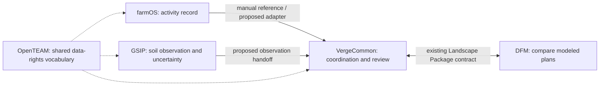

# A woodlot, a soil note, and a decision people can inspect

Conservation first-use packet · prepared October 12, 2026 · synthetic data only · published synthetic example.

**The question:** A fictional co-op is considering a harvest beside a retained woodland connection. Can builders keep the observation, landholder permissions, planning assumptions and review decision understandable as records move between tools?

**The useful result:** identify the treatment that breaks the modeled connection, compare a deferral, and prepare a traceable field note for human review. No soil measurements, ecological outcomes or real land permissions are established by this exercise.

## How the projects fit



OpenTEAM is a community and governance reference, not a runtime connector or endorsement. The DFM–VergeCommon file contract exists; the full five-project workflow is a proposed manual exercise, not an automatic integration.

| Project | Contribution to this exercise | What is verified here |
| --- | --- | --- |
| [farmOS](https://github.com/farmOS/farmOS) | Keep a dated Activity log that points to the observation ID. | Minimal CSV follows the previously validated `name,timestamp` shape. No new farmOS import executed. |
| [GSIP](https://github.com/global-soil-intelligence/gsip) | Capture a soil observation under its protocol; show the estimate basis and uncertainty when available. | Current source/docs inspected. This packet uses an authored narrative, no GSIP submission, photograph, estimate or API export. |
| [VergeCommon](https://github.com/jdhart81/verge-common) | Coordinate the activity, record evidence and consent, then obtain another steward's review. | Its current field-draft parser accepts the included note. Importing a draft grants no authority or review status. |
| [DFM](https://github.com/jdhart81/hdfm-framework) | Start with roads/waterways and compare woodland treatments with traceable inputs. | Current public `dfm-core` 0.3.0 runs both synthetic Landscape Packages locally and deterministically. |
| [OpenTEAM](https://openteam.community/) | Help builders distinguish collection, access, export, publication and withdrawal. | Seven illustrative permission cases pass. The worksheet is an independent proposal, not official certification or accepted framework content. |

## First use: start with the smallest working result

Allow about 10 minutes for the local packet; the optional application walkthrough may take 30–60 minutes plus setup. These are estimates, not measured onboarding times.

1. Open `SHOWCASE.html` for the visual story. Read the fictional-observation card: soil estimates are **unavailable**, not zero.
2. Run the local demonstration from this packet directory with Node 22 or newer:

   ```sh
   npm ci --ignore-scripts --no-audit --no-fund --prefix vendor/packages/dfm-core
   node run-demo.mjs
   ```

   Dependencies come from the upstream lockfile. Installation needs registry access; the demonstration itself makes no network requests and does not start a server.
3. Read `results.json`: the baseline reports `fail` and identifies `harvest-3`; the deferral reports `pass`, with no lost links. This is a modeled structural check, not evidence of species movement or a recommendation to harvest elsewhere.
4. Inspect `fixtures/verge-field-draft.json` and `fixtures/farmos-activity.csv`. Both refer to `obs-synthetic-001`. They carry human-readable context; they do not synchronize records automatically.
5. Inspect `fixtures/consent.json`: future public-summary publication is denied at and after withdrawal, while the fictional steward's separate own-record export remains permitted. Live/backup erasure and prior-recipient reconciliation remain pending.
6. Answer: **Which treatment caused the break? What remains unknown? Who must review the note? What may still be exported after publication withdrawal?**

Success means the builder can explain those four answers and identify the first confusing step. Running this packet does not count as independent adoption.

## Optional manual application walkthrough

Use isolated local instances and fictional records. Installation and credentials stay under each project's own instructions; this packet does not provision services or authorize production writes.

1. **farmOS — record the activity.** Download the Activity CSV template from your own instance, confirm its installed-module columns, and import `fixtures/farmos-activity.csv` only if the template matches. Confirm exactly one log and the timestamp `2026-10-12T12:00:00Z`. Retain the log ID privately. The CSV records an activity, not quantified soil evidence. The contributed documentation PR [#1107](https://github.com/farmOS/farmOS/pull/1107) is still awaiting upstream review.
2. **GSIP — inspect capture readiness.** Follow its current contributor guide and capture protocol. For this first packet, read `fixtures/observation.json`; no photos or location are submitted. A future authorized staging exercise can capture synthetic/test soil imagery and verify sanitation, coarse public location, permissions and uncertainty. Preserve current launch/legal/deployment gates. Do not treat the older July deployment handoff as current runtime qualification.
3. **VergeCommon — prepare a reviewable note.** Create a fictional local co-op/project and private parcel using the current guide. In the field-observation form, use its optional field-draft importer with `fixtures/verge-field-draft.json`. Confirm the parcel and date/time zone, then explicitly save if doing the local exercise. A separate steward reviews it. Record the farmOS/GSIP references in the note; neither a pasted ID nor group membership proves authority or consent.
4. **DFM — compare plans.** The included Landscape Packages are for `dfm-core`, not the web-map GeoJSON importer. The local demonstration reads them directly. To explore the web workspace instead, start its local application and load `fixtures/fictional-watershed.geojson`, then compare illustrative 30 m and 50 m waterway buffers with a 6 m assumed full road width. Those widths are desk-exercise choices, not ecological or regulatory prescriptions. Save/export both scenario records. Do not compare those web scenarios numerically with the separate connectivity fixture as if they were the same analysis.
5. **VergeCommon + OpenTEAM — review the decision.** Keep assessment files private, record sources and limitations, and propose the next field question rather than claim a verified conservation outcome. Rehearse publication withdrawal using the synthetic worksheet. Ask a reviewer whether the permission vocabulary and proposed handoff are understandable before any real integration or publication.

## What builders could contribute next

Start with `BUILDER_HANDOFF.md`: one proposed adapter from a reviewed observation to a Verge field draft and farmOS activity, with explicit unknowns and separate permissions. It should produce drafts, never silently publish, approve, or treat an estimate as a measured value.

Credit farmOS and OpenTEAM as independent projects. This packet does not claim partnership or their acceptance of our proposed integration. Existing third-party code and fixture notices are in `ATTRIBUTION.md`.

See `FIRST_USE_PROTOCOL.md` for the one focused adoption experiment and `VALIDATION.md` for exact evidence and remaining gaps.
