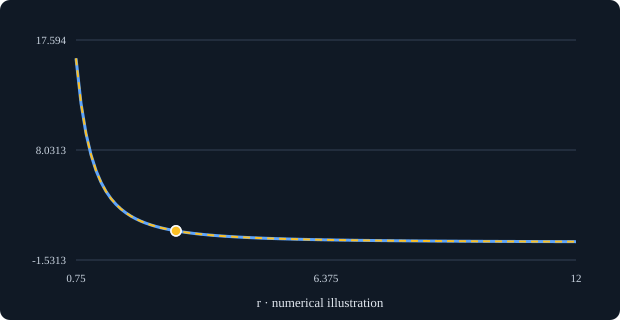

# Use ProofLens alongside your theorem documentation

Start with one public or synthetic statement you actually want to understand. No account, installation, or payment is required for the browser path. This is a maintainer-tested example, not a report of outside adoption.

## 1. Try a statement

Open https://jdhart81.github.io/prooflens/, expand **Explore your own Lean**, paste `statement.lean`, and choose **Visualize statement**.

The included admitted statement compares `C / ((2*r)*(2*r))` with `(C/(r*r))/4`. Set C = 36 and r = 3: both sides display 1. Choose r as the horizontal axis. At r = 6 both sides display 0.25. At r = 0 the positive-r assumption fails and division is undefined in the numerical illustration. The chart is not a proof. The input ends in `sorry`, and ProofLens marks it unproved.

Then replace this fixture with one small supported statement from your own work. Record the question you had before opening the app. If custom definitions or syntax are unsupported, keep the rejection and the smallest public example; do not rewrite a research claim just to make a picture appear.

## 2. Save a useful artifact

**Save chart** downloads SVG and **Save explanation** downloads Markdown. Keep the original statement, assumptions, source revision, and proof status beside them. The included `quarter_after_doubling.svg` is the actual browser export at C=36, r=3; it retains numerical-preview limitations in its SVG description. Preserve those qualifications in visible text when embedding.

## 3. Use it in a documentation page

For plain HTML, keep a locally served SVG beside the page:

```html
<figure>
  
  <figcaption>Source preview, not checked by Lean. C=36, r=3; C and r positive. The statement uses sorry. Floating-point examples are not a proof.</figcaption>
</figure>
```

This static companion can sit alongside a project's README or theorem documentation. For a leanblueprint project, link to the companion page from your project documentation; there is no tested leanblueprint plugin or automatic blueprint build integration here. Do not change generated blueprint files or upstream tool settings for this trial. Confirm with the project maintainer where a companion belongs before publishing into their project.

## 4. Optional local reproducible output

This packet also contains a separate CLI example: `ProofLens.Examples.simple_upper_bound`, with an upper-bound figure, an assumption-use figure, and the layered explanation. It uses committed extracted IR at ProofLens revision `7beff99e55aa9f341b49a7eeea1d8560dafbc627`.

With Node 22.12+ in the 22.x line or Node 24.x and pnpm 10.28.0:

```bash
git clone https://github.com/jdhart81/prooflens
cd prooflens
git checkout 7beff99e55aa9f341b49a7eeea1d8560dafbc627
pnpm install --frozen-lockfile --ignore-scripts
pnpm build
pnpm prooflens render examples/corpus.formal-ir.json ProofLens.Examples.simple_upper_bound --out-dir docs-output --format both
pnpm prooflens explain examples/corpus.formal-ir.json ProofLens.Examples.simple_upper_bound
```

This renders existing extracted metadata without running a fresh Lean build. The fixture proof returns h directly; hP and hT are unused by that proof term. This does not establish that positivity is unnecessary for another claim or its physical interpretation. Author-supplied physical labels are interpretations, not empirical validation.

For your own Lean project, use the [existing extraction guide](https://github.com/jdhart81/prooflens/blob/7beff99e55aa9f341b49a7eeea1d8560dafbc627/docs/quickstart.md). Preview, extraction metadata, fresh kernel checks, and numerical pictures remain separate.

## 5. Tell us what worked or blocked you

[Open the first-use report](https://github.com/jdhart81/prooflens/issues/new?template=builder_trial.yml), or reply to the [community discussion](https://github.com/jdhart81/prooflens/discussions/4). Include your original question, public/synthetic example, outcome in your words, first friction, and where you would use the output. No private research or contact details needed. Participation is optional; public replies are visible to everyone. A failed useful attempt is welcome.

We are looking for one independent useful result, then a return for a different real task or a maintainer-approved documentation use. A completed exercise, star, contribution, and integration are different evidence. We will ask separately before using a participant quote in a showcase.

## Attribution and validation

ProofLens: Justin Hart and its contributors, Apache-2.0 source license. [Source](https://github.com/jdhart81/prooflens/tree/7beff99e55aa9f341b49a7eeea1d8560dafbc627). Original guide and fixture: Justin Hart, CC BY 4.0. Generated examples retain their source attribution and all proof-status qualifications; no endorsement by Lean, mathlib or leanblueprint is implied.

Maintainer check, October 12, 2026: browser accepted the source fixture and showed 1=1 at C=36,r=3; Save chart produced the included SVG with r as horizontal axis. Locked Node24/pnpm build and local CLI rendering succeeded. New source proof compilation and upstream leanblueprint integration were not performed. Outside useful use and repeat use remain unconfirmed.
